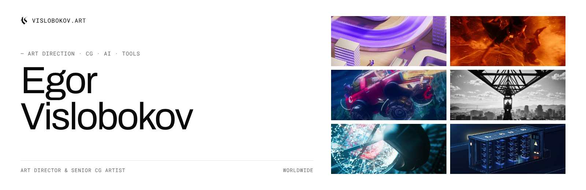
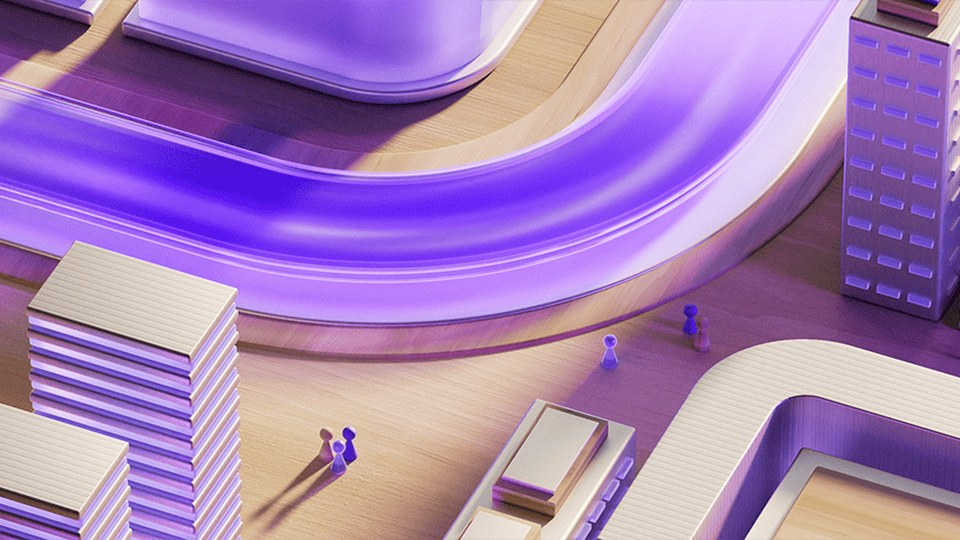
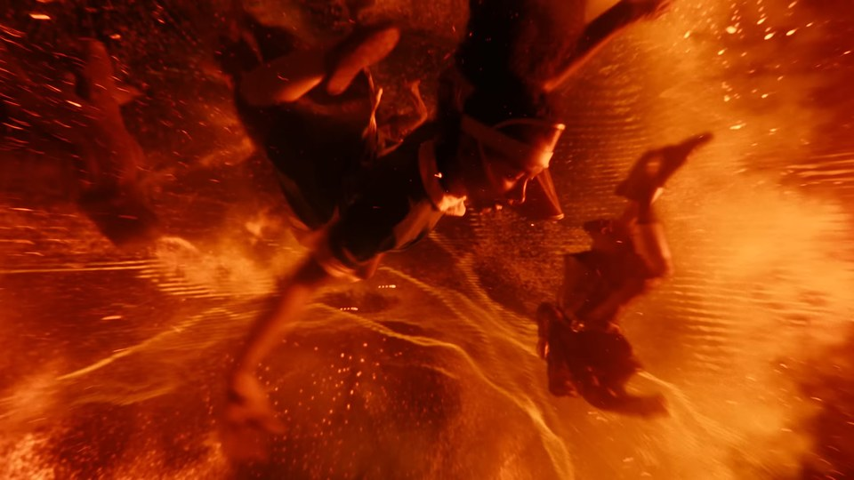
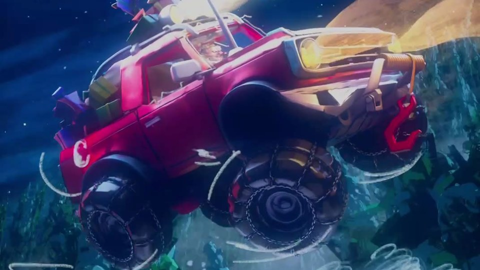
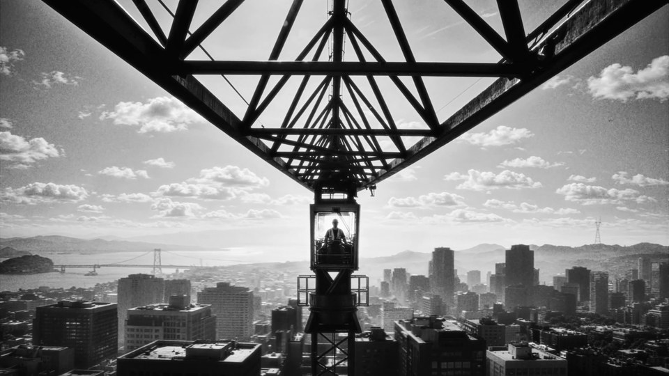
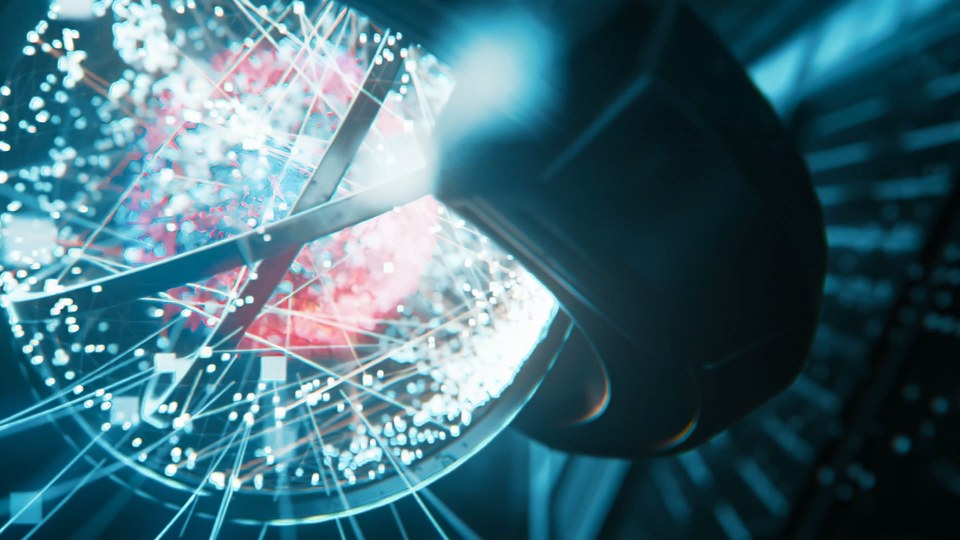
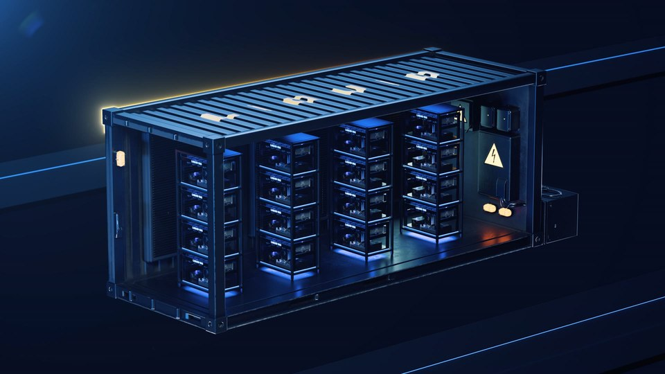

<a href="https://vislobokov.art">
  <picture>
    <source media="(prefers-color-scheme: dark)" srcset="assets/banner-dark.png">
    
  </picture>
</a>

### Hi, I'm Egor

Art director and senior CG artist with over 7 years in visual communication design and CG. I studied graphic design at the Stroganov Academy and usually run both sides of a project: the creative direction and the 3D production behind it. I work with local and international brands on commercials, brand films and key visuals.

Here I publish the tools I build for my own CG and AI pipeline: plugins, scripts and MCP servers.

### Tools

| | Repo | What it does | Stack |
|---|---|---|---|
| 001 | [**vslon_ae_mcp**](https://github.com/vs1on/vslon_ae_mcp) | Control Adobe After Effects from Claude and other MCP clients. A CEP bridge inside After Effects plus a zero-dependency MCP server: read projects, edit comps, run ExtendScript and render. | After Effects · MCP · Python |

All tools are also listed on [vislobokov.art/tools](https://vislobokov.art/tools).

### Selected work

<table>
  <tr>
    <td width="33%"> <b>HFCL</b> · CGI · 2025</td>
    <td width="33%"> <b>Muse – Nightshift Superstar</b> · CGI · 2026</td>
    <td width="33%"> <b>ZheeShee Happy NY</b> · CGI · 2026</td>
  </tr>
  <tr>
    <td> <b>Yandex | Flowers</b> · CGI · 2026</td>
    <td> <b>BCS ML</b> · CGI · 2024</td>
    <td> <b>Liquid Mining</b> · CGI · 2022</td>
  </tr>
</table>

More on [vislobokov.art](https://vislobokov.art).

### Stack

### Contact

